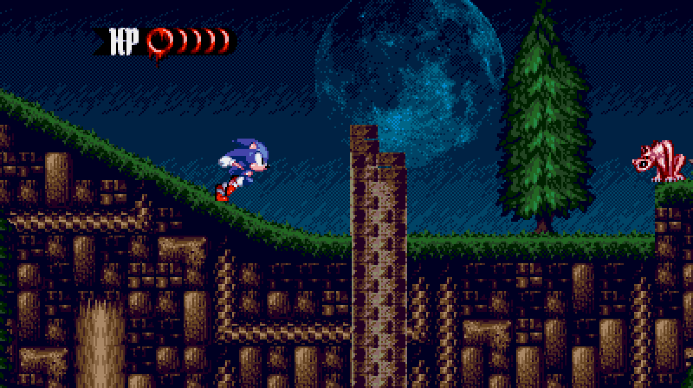
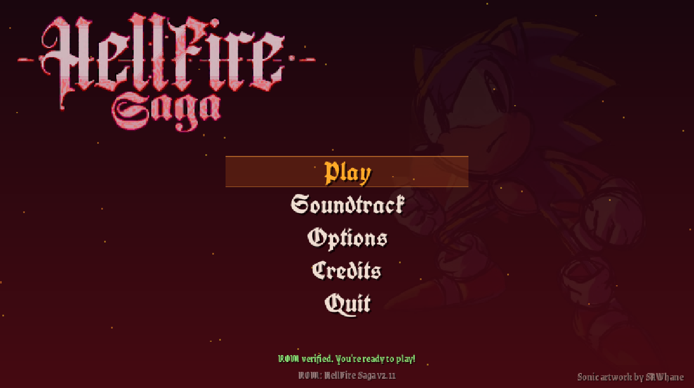
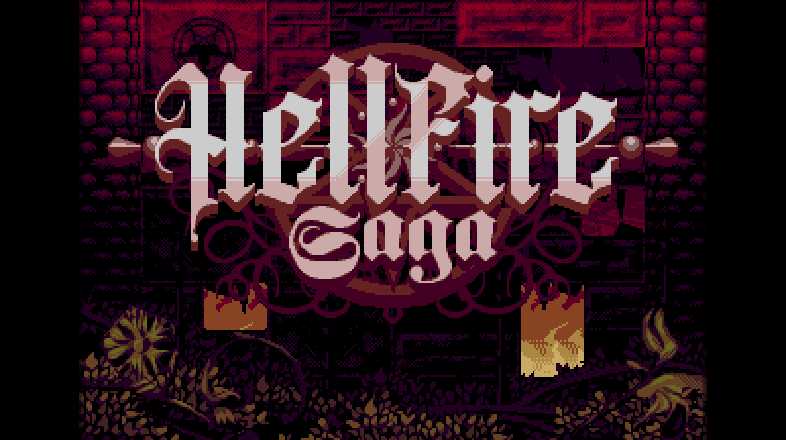
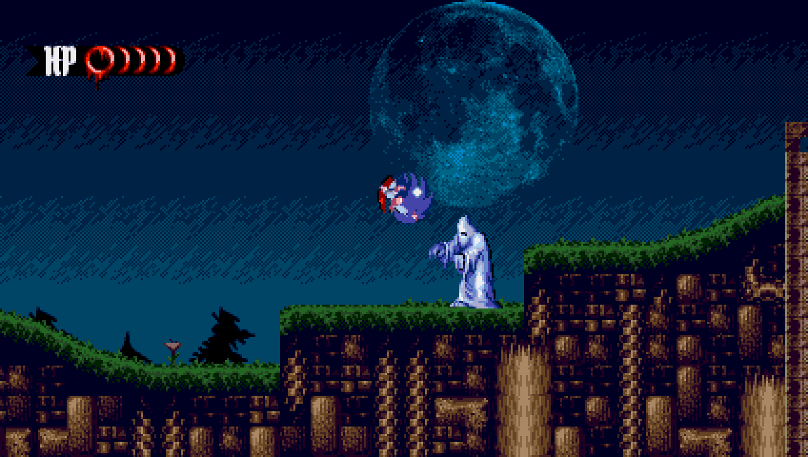
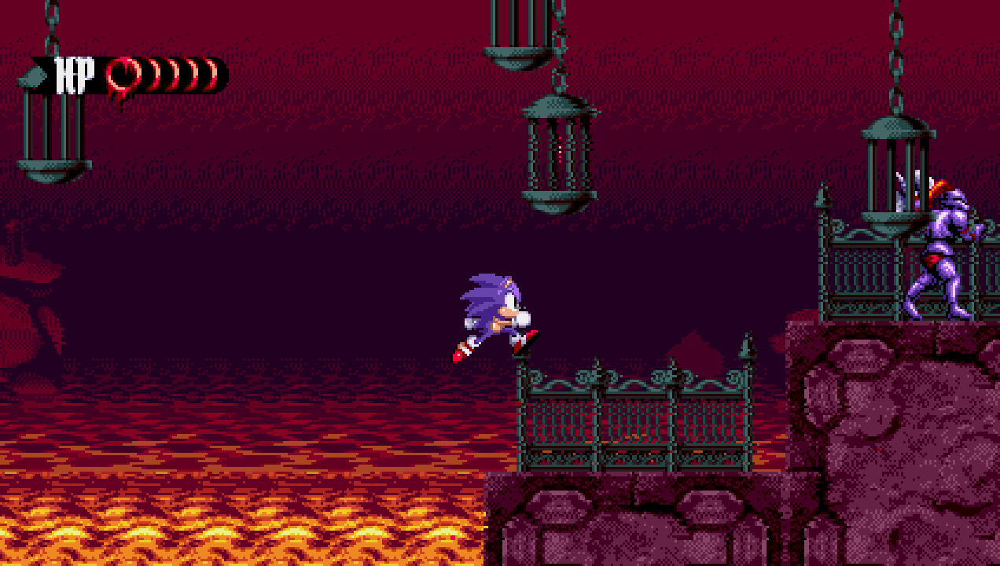
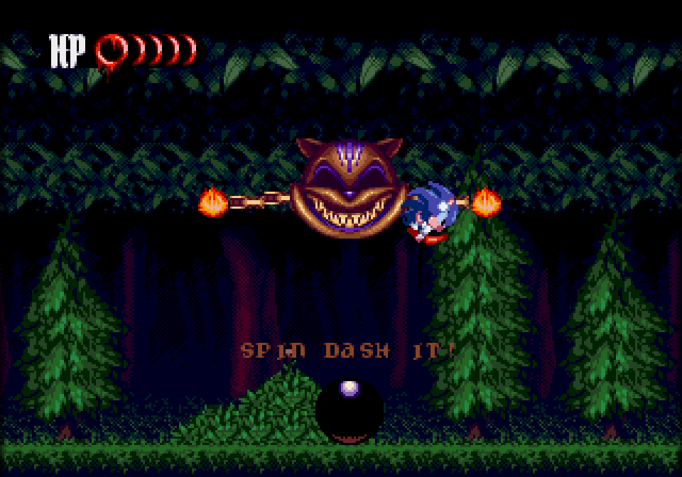
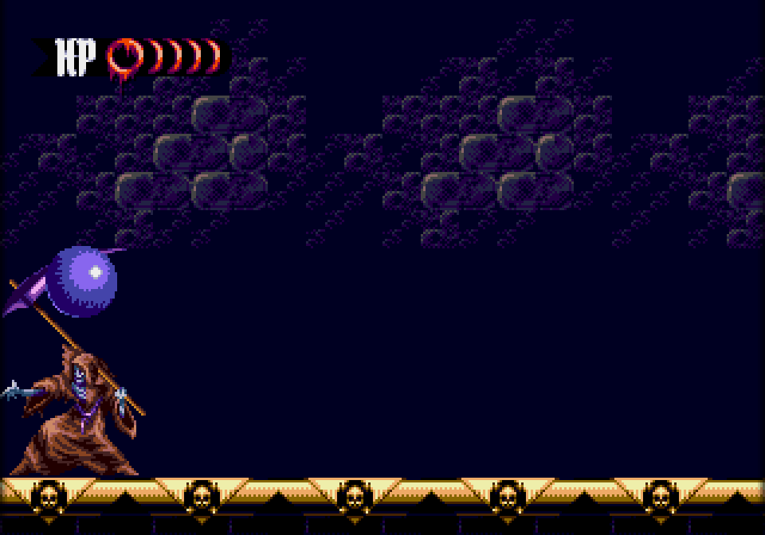
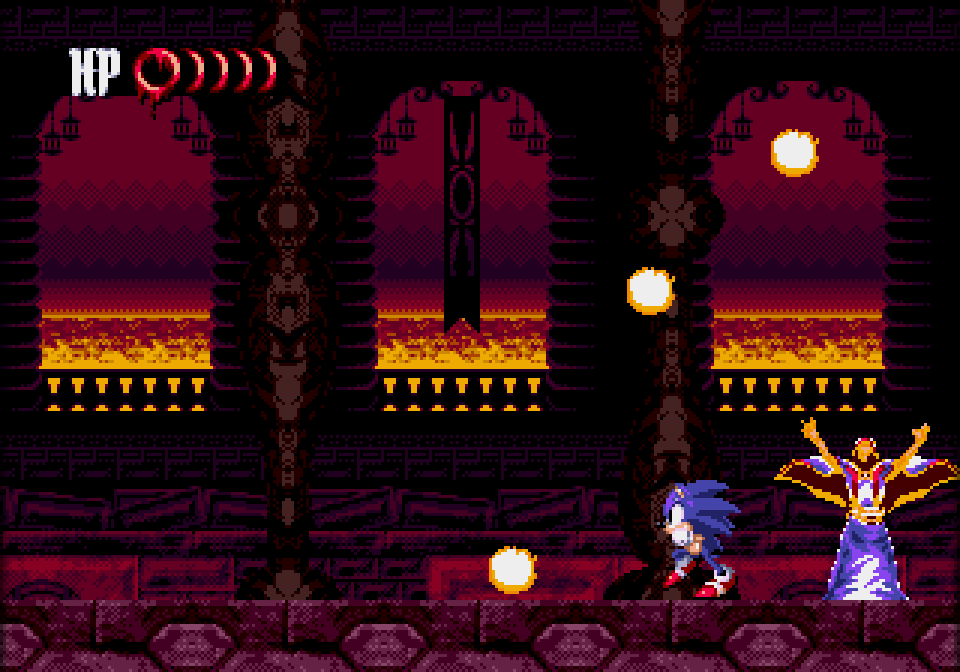

<h1 align="center">HellFire Saga PC</h1>

<p align="center">A native PC port of <b>Sonic the HellFire Saga</b>, one of the best Sonic hacks ever, for Windows and Linux.<br>400×224 widescreen, black bars for boss fights, a soundtrack player, and the game's code recompiled to native C.<br>Made by Vibe Slop Studios.</p>

<p align="center">
  <a href="https://github.com/thebradshaw/hellfire-saga-pc/releases/latest/download/hellfire-saga-pc-windows-x64.zip"></a>
  &nbsp;
  <a href="https://github.com/thebradshaw/hellfire-saga-pc/releases/latest/download/hellfire-saga-pc-linux-x64.tar.gz"></a>
</p>
<p align="center"><a href="https://github.com/thebradshaw/hellfire-saga-pc/releases/latest"></a></p>

<p align="center"></p>

**To play:** download, unzip, run `hellfire` (`hellfire.exe` on Windows), drag your ROM onto the window and press **Play**.

**You need your own ROM.** No game data is in this repository or its downloads. Patch your own Sonic 3 ROM with the HellFire Saga v2.11 patch, and the launcher checks the result:

- HellFire Saga v2.11, already patched (the launcher doesn't patch)
- SHA-1 `f8f57b7295c93ee30fc02340051d081a060f8e17`

A fan project, not affiliated with or endorsed by SEGA or the HellFire Saga team. Sonic the Hedgehog is a trademark of SEGA.

The download buttons always get the latest release; older ones are on the [releases page](../../releases). The Linux build needs SDL2 (`sudo apt install libsdl2-2.0-0`).

| | |
|---|---|
|  |  |
| The launcher, with art by SAWhane | The title screen |





| | | |
|---|---|---|
|  |  |  |
| The Forest of Decay boss | Death | Shaft |

Bosses and cutscenes close in to the original 320×224 picture, as the game was built for it.

<p align="center"><a href="https://buymeacoffee.com/chrisbradshaw"></a></p>

## Features

- Widescreen at **400×224**: 16:9 at the Genesis's native height
- A **Sonic Mania mode at 424×240** (the default), Mania's own picture size: wider again, and 16 lines taller, with the level drawn past the old top and bottom edges and the health meter moved out to the corner. Pick it or the others under Options → Screen (Mania 424×240, 400×224 or the original 320×224)
- A launcher with art by **SAWhane**
- Black bars that slide in during boss fights and cutscenes, so those play at the original 320px width (in Mania mode they close in from all four sides, to the original 320×224), then slide back out; they stay on for screens made only 320px wide (title, menus, results, the final boss and the ending)
- 60 or 120 FPS presentation, with VSync on or off; frame pacing locks to
  the display's measured refresh rate for smooth motion
- CRT effect: scanlines, or scanlines plus an RGB mask
- Optional invincibility: enemies and drowning can't hurt you, but spikes,
  pits and being crushed still do
- Fixes for small bugs in the game, like the drowning countdown digits
- A soundtrack player: every sound test track, with the official album's
  track names, played by the game's own sound driver from your ROM
- Mouse support in the launcher and pause menu (click, right-click = back,
  wheel scrolls)
- Game logic recompiled to native C from your own ROM at launch (see
  [Native code](#native-code)); the emulated 68000 stays as a fallback

## Playing

1. Patch your own Sonic 3 ROM with the HellFire Saga v2.11 patch.
2. Run `hellfire` (or `hellfire.exe`) and drag the patched `.gen`/`.bin` onto the window.
   You can also pass it on the command line: `hellfire path/to/HellfireSaga.gen`.
3. The launcher remembers the file. Press **Play**.

| Action | Keyboard | Controller |
|---|---|---|
| D-pad | Arrow keys | D-pad / left stick |
| A / B / C | Z / X / C | X / A / B (Xbox layout) |
| X / Y / Z | A / S / D | LB / Y / RB |
| Start | Enter | Start |
| Pause menu | Esc | Guide |
| Fullscreen | F11 or Alt+Enter | |

Settings and battery saves are stored in `%APPDATA%\HellFireSagaPC\hellfire\` (Windows) or `~/.local/share/HellFireSagaPC/hellfire/` (Linux).

## Building

**Linux**

```sh
sudo apt install build-essential cmake libsdl2-dev
cmake -B build -DCMAKE_BUILD_TYPE=Release
cmake --build build -j
./build/hellfire
```

**Windows** (cross-compiled from Linux or WSL with MinGW-w64)

```sh
sudo apt install mingw-w64
curl -LO https://github.com/libsdl-org/SDL/releases/download/release-2.30.9/SDL2-devel-2.30.9-mingw.tar.gz
tar xzf SDL2-devel-2.30.9-mingw.tar.gz
cmake -B build-win -DCMAKE_BUILD_TYPE=Release \
  -DCMAKE_TOOLCHAIN_FILE=cmake/mingw-w64.cmake \
  -DSDL2_DIR=$PWD/SDL2-2.30.9/x86_64-w64-mingw32/lib/cmake/SDL2
cmake --build build-win -j --target hellfire
```

GitHub Actions builds both on every pull request. Download them from the run's **Artifacts**.

**Smoke test.** This boots a ROM headless, runs N frames and writes a screenshot:

```sh
./build/hellfire_smoketest HellfireSaga.gen out 2400 10   # 10 extra columns = 400px
./build/hellfire_smoketest HellfireSaga.gen out 2400 13   # 13 extra columns = Mania mode, 424x240
```

**Recompiler checks:**

```sh
# every 68000 opcode, recompiled and run against the interpreter from random states
./build/hellfire_recomp_fuzz 1 4
# the whole game: N frames on the interpreter, then N on native code, same input;
# RAM, VRAM, CRAM, VSRAM, Z80 RAM, CPU registers and audio compared every frame
./build/hellfire_recomp_check HellfireSaga.gen 3000 10
```

On Linux, `HF_NATIVE_CC="gcc -O1"` makes the game and the checker build the
native code with gcc instead of TinyCC (slow to compile, faster to run).

## How it fits together

```
src/main.c        main loop, frame pacing (vsync lockstep on 60 Hz screens)
src/launcher.c    ROM setup, menus, options, credits, pause menu
src/gfx.c         tiny software renderer: rectangles, baked gothic fonts, images
src/video.c       one SDL texture, pixel-perfect or fit scaling
src/audio.c       short SDL audio queue with drift correction (low latency)
src/controls.c    keyboard + SDL game controllers
src/romcheck.c    SHA-1 check of the player's ROM
src/widescreen.c  in-memory patches so the game draws level + sprites 400px wide (or 424x240)
src/gamefx.c      boss/cutscene bars, SEGA screen fix, game bug fixes, invincibility
src/soundtrack.c  soundtrack player (boots the ROM, freezes it, runs its sound driver)
src/emu.c         the only file that talks to the hardware core
src/native.c      runs recompiled code in the 68000's place, interpreter fallback
src/recomp/       68000 decoder, C generator, runtime prelude, compiler glue
third_party/tinycc      TinyCC (libtcc), compiles the recompiled C in memory
src/osd.h         glue header the core expects
third_party/gpgx-wide   Genesis Plus GX Wide: 68000, Z80, VDP, YM2612, PSG in C
```

## Native code

At game start the launcher reads your ROM (with the widescreen and fix
patches applied) and the recompiler in `src/recomp` turns its 68000 code
into C: about 55,000 instructions found by following the code from the
reset and interrupt vectors, jump tables and pointer tables. The bundled
[TinyCC](https://github.com/TinyCC/tinycc) compiles that C (about 20 MB) in
memory in under a second, and the CPU loop calls it instead of
interpreting. The
generated C lives only in memory on your PC; nothing from the ROM is
stored in this repo.

- The C works on the same CPU state as the interpreter (registers, flags,
  cycle counts, bus timing), so the two can hand over at any instruction.
  The graphics and sound chips are unchanged.
- Rare instructions (BCD maths, MOVEP, TRAP, RTE, changes to SR) call the
  interpreter's own handler for that one instruction.
- Code the recompiler didn't find runs on the interpreter. Its addresses
  are saved to `native_entries.txt` in the settings folder and included the
  next time, so coverage grows.
- Code the game patches at runtime (invincibility, soundtrack player) is
  checked by a hash per 2 KB block; changed blocks fall back to the
  interpreter.
- **Game code** in the launcher's options switches between native and
  emulated.

Every opcode form was checked against the interpreter (614,400 random
states, 0 differences). The game runs identical to step 1, byte for byte,
for 20,000 frames in widescreen and 8,000 at 320px on Linux, and 3,000 on
the Windows build.

## Status

**1.0.** Everything planned is in: the playable base, native code, widescreen, boss bars and the soundtrack player.

- **Playable base**: launcher, ROM check, 400×224, Windows and Linux builds.
- **Native code**: the ROM's 68000 code is recompiled to C on your PC and replaces the emulated CPU, checked frame by frame against the emulated build.
- **Widescreen**: the level and sprites fill 400px (`src/widescreen.c`).
- **Mania mode**: 424×240, on a toggle with 400×224 and the original 320×224.
- **Boss black bars** (`src/gamefx.c`): bosses are detected when the game pins the camera (the final boss by its zone), and cutscenes when it takes control away from the player.
- **Soundtrack**: every track from your ROM, played in the launcher.

Found a spot where widescreen looks wrong, such as a boss arena or a level edge? Please [open an issue](../../issues) with a screenshot.

## Credits

This port is made by **Vibe Slop Studios**.

If you enjoy it, you can [buy me a coffee](https://buymeacoffee.com/chrisbradshaw).

- Sonic the HellFire Saga by the HellFire Saga team
- Launcher art by SAWhane
- Sonic the Hedgehog 3 © SEGA. This is an unofficial, free fan project.
- [Genesis Plus GX](https://github.com/ekeeke/Genesis-Plus-GX) by Eke-Eke and Charles MacDonald, and its
  [widescreen fork](https://github.com/libretro/Genesis-Plus-GX-Wide). Their non-commercial license
  (`third_party/gpgx-wide/LICENSE.txt`) means builds of this project may not be sold.
- Fonts: [UnifrakturCook](https://fonts.google.com/specimen/UnifrakturCook) by j. 'mach' wust and Peter Wiegel, and
  [Grenze Gotisch](https://github.com/Omnibus-Type/Grenze-Gotisch) by Omnibus-Type (both SIL Open Font License,
  see `assets/fonts/`). Baked to images with `tools/bake_font.py`.
- [TinyCC](https://github.com/TinyCC/tinycc) by Fabrice Bellard and contributors (LGPL 2.1,
  `third_party/tinycc/COPYING`), built into the game unchanged; this repo is its full source
- [font8x8](https://github.com/dhepper/font8x8) by Daniel Hepper (public domain)
- [stb_image](https://github.com/nothings/stb) by Sean Barrett (public domain / MIT)
